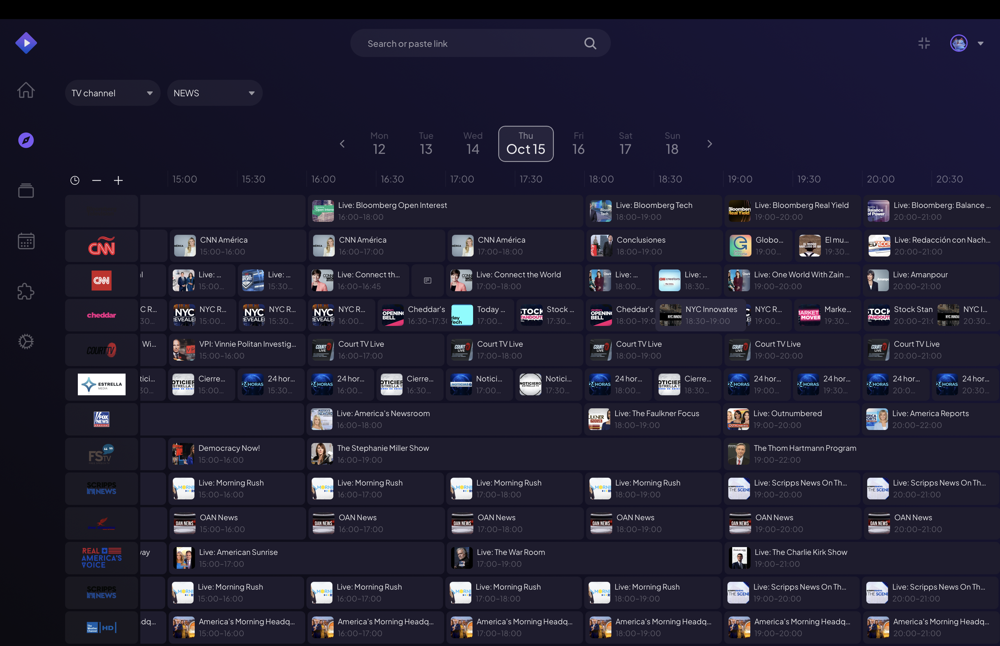
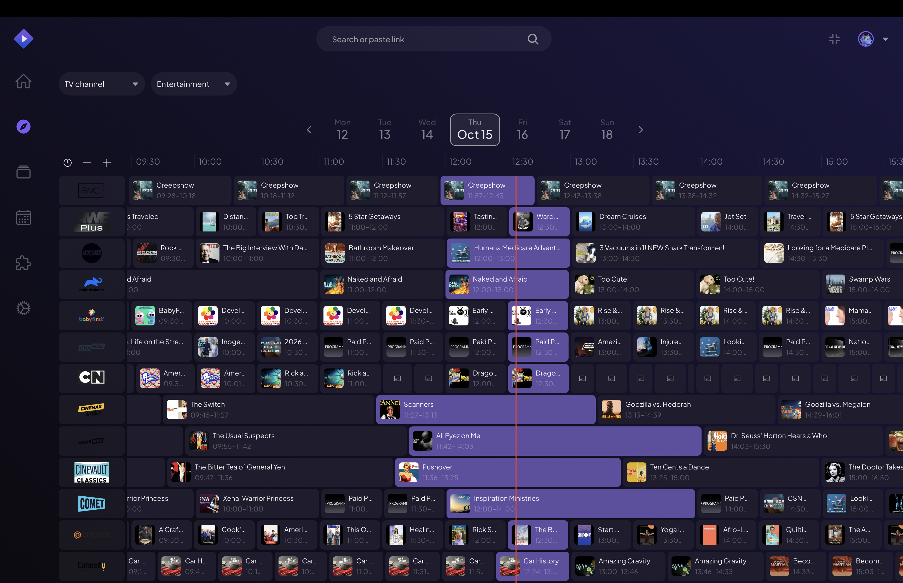
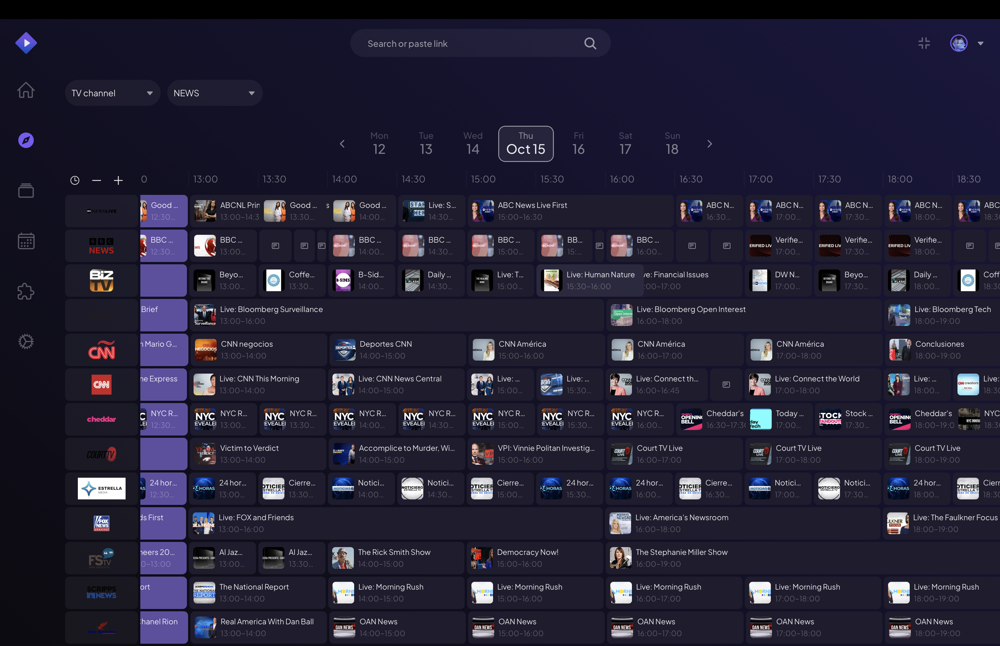

# onair-stack

**onair-stack** is a self-hosted live-TV backend for Stremio. A background worker crawls public IPTV playlists, broadcaster APIs and EPG feeds around the clock, verifies that every stream really plays, and stores channels, streams and programme schedules in Postgres. A companion Stremio addon then serves that catalogue — including a native TV guide — so you can browse a channel lineup, see what is on right now, and press play without leaving the app.

```
sources (m3u playlists / broadcaster APIs / EPG feeds)
   -> collector  (fetch -> verify -> normalise -> upsert Postgres)
   -> onair      (Stremio catalog / meta / stream reads Postgres)
   -> Stremio client
```

Both services are Node 24+ / TypeScript / ESM, talk to the same Postgres schema through a
Prisma 8 contract, and are deployed independently (the addon as a long-running HTTP
service, the worker as a cron process or a Kubernetes CronJob).

## Screenshots

The `onair` addon's channels rendered in Stremio's TV guide:





## Layout

```
onair-stack/
  onair/      # Stremio addon HTTP server (serves catalog / meta / stream + EPG)
  collector/  # Cron-driven scraper worker (fills Postgres, exposes no HTTP)
```

## Deploy with Docker Compose

The whole stack — Postgres, schema bootstrap, addon and worker — ships in
[`docker-compose.yml`](docker-compose.yml):

```bash
cp .env.example .env      # optional: override ports, credentials, Sentry
docker compose up -d --build
```

Compose reads `docker-compose.yml` from the repository root and `.env` for the
overrides. That brings up Postgres, bootstraps the schema from the shared contract, then
starts the addon and the worker. The addon is served on
`http://localhost:8080/manifest.json` — paste that URL into Stremio's "Install addon"
dialog.

| Service | Purpose | Port |
| --- | --- | --- |
| `db` | Postgres 16, data in the `pgdata` volume | 5432 |
| `migrate` | one-shot: creates and signs the schema, then exits | — |
| `onair` | the Stremio addon | 8080 |
| `collector` | the scraper worker (in-process cron) | — |

```bash
docker compose logs -f collector   # follow the worker
docker compose down                # stop, keep the database
docker compose down -v             # stop and delete the database volume
```

The worker runs its own cron scheduler by default; set `RUN_ONCE=true` in `.env` to turn
it into a one-shot pass instead (for an external scheduler or a Kubernetes CronJob) — and
`COLLECTOR_RESTART=no` alongside it, so Docker does not restart the finished pass.

## Data model

Both services use the same Prisma 8 contract (`src/prisma/contract.prisma` — the two
copies are identical):

- **Channel** — `name`, unique `slug`, `country`, `category`, `poster`, `description`,
  `externalId` (online-television.com key)
- **Stream** — `channelId`, `name`, unique `slug`, `url` (verified m3u8), `resolution`
  (`4k | hd | sd | unknown`), `language`, `youtubeId`
- **Schedule** — `channelId`, programme `name`, `poster`, `description`, `date`,
  `startTime`, `endTime`

`category` is an enum with 17 values (`ENTERTAINMENT`, `SPORTS`, `MOVIES`, `NEWS`,
`INTERNATIONAL`, `RADIO`, `RELIGIOUS`, `DOCUMENTARY`, `MUSIC`, `KIDS`, `SHOPPING`,
`LIFESTYLE`, `CLASSIC_TV`, `CRIME`, `ADULT`, `OUTDOORS_AUTO`, `GENERAL`).

---

## onair — Stremio addon

The HTTP service. Exposes a standard Stremio manifest and reads **only** from Postgres —
it never scrapes.

- Manifest `community.onair` (v1.0.1), type `tv`, resources `catalog` / `stream` / `meta`,
  `behaviorHints: { configurable: false, epgProvider: true }`, and the `skip` / `search` /
  `date` catalog extras.
- **Catalog** — channels of a category that have at least one stream, ordered
  alphabetically by name, 100 per page (`skip`). Searches match channel names
  case-insensitively.
- **Meta** — a single channel plus today's and tomorrow's programmes, so the detail page
  survives a midnight refresh.
- **Streams** — every stream of a channel as `{ url, name, description }`, where description
  is `"<resolution or SD> - <language>"`.
- **Catalogs** — `ENTERTAINMENT`, `SPORTS`, `MOVIES`, `NEWS`, `INTERNATIONAL`, `RADIO`,
  `RELIGIOUS`, `DOCUMENTARY`, `MUSIC`, `KIDS`, `SHOPPING`, `LIFESTYLE`, `CLASSIC_TV`,
  `CRIME`, `OUTDOORS_AUTO`.
- **Native EPG** — when Stremio asks for a catalog with `extra.date`, the addon returns
  `metasDetailed`: one meta per channel with the programmes airing during that UTC day as
  `videos`. Responses carry EPG cache headers (`max-age 300`, `stale-revalidate 1800`,
  `stale-error 604800`) because programme data goes stale fast.
- **Observability** — Sentry metrics: `catalog-request`, `catalog-epg-request`,
  `catalog-search-request`, `catalog-meta-request`, `catalog-stream-request`.
- **Publishing** — calls `publishToCentral(CENTRAL_URL)` when `NODE_ENV=production` and
  `CENTRAL_URL` is set.
- **Fallback artwork** — posters and logos fall back to a Cloudinary-hosted image.
- **Docker** — `onair/Dockerfile` (node:26-alpine), exposes `8080`,
  `CMD ["node", "dist/src/server.js"]`.

Config (env): `DATABASE_URL`, `PORT`, `LOGO_URL`, `SENTRY_DSN`, `CENTRAL_URL`.

Run:

```bash
cd onair
cp .env.example .env
npm install
npm run dev    # tsx watch src/server.ts
npm run build && npm start
```

For a full stack (Postgres + addon + worker), use
[`docker-compose.yml`](docker-compose.yml) at the repository root.

---

## collector — scraper worker

Keeps `Channel` / `Stream` / `Schedule` fresh. Exposes **no HTTP server** — scheduling is
in-process `node-cron` (wrapped by [Cronitor](https://cronitor.io) for monitoring) or a
one-shot `RUN_ONCE=true` pass, which is what a Kubernetes CronJob runs.

The list of registered jobs, their cron schedules and their sources is documented in
[`collector/README.md`](collector/README.md).

Config (env): `DATABASE_URL`, `RUN_ONCE`, `TZ`, `LOG_LEVEL`, `HTTP_TIMEOUT_MS`,
`HTTP_MAX_RETRIES`, `HTTP_USER_AGENT`, `STREAM_HEALTH_BATCH_SIZE`,
`STREAM_HEALTH_TIMEOUT_MS`, `STREAM_HEALTH_DEEP_CHECK`, `STREAM_HEALTH_MAX_DELETE_RATIO`,
`SENTRY_DSN`, `SENTRY_ENVIRONMENT`, `SENTRY_TRACES_SAMPLE_RATE`, `CRONITOR_API_KEY`.

Run:

```bash
cd collector
cp .env.example .env
npm install
npm run dev         # long-running scheduler
npm run dev:once    # RUN_ONCE=true: run all enabled jobs once and exit
npm run build && npm start
npm run start:once  # production one-shot (K8s CronJob)
```

For a full stack (Postgres + addon + worker), use
[`docker-compose.yml`](docker-compose.yml) at the repository root.

---

## Database

Both services use the Prisma 8 contract pattern:

1. Edit the models in `src/prisma/contract.prisma` (keep the two copies in sync).
2. Run `npx prisma contract emit` to regenerate `contract.json` + `contract.d.ts`
   (`npm run contract:emit` in `onair`).
3. Apply the SQL in `migrations/`.

## Development

- Node >= 24 (`engines`), `.nvmrc` pins `v26.2.0`; PostgreSQL >= 15.
- Per service: `npm run lint`, `npm run typecheck`, `npm run build`.
- CI (`.github/workflows/ci.yml`) lints, typechecks, tests and builds each changed
  module; `docker-collector.yml` publishes the collector image to Docker Hub on `main`.

## Notes

- `ENABLED_JOBS` and `STREAM_HEALTH_CRON` are still listed in `collector/.env.example` but
  are **not read** by the worker: jobs are toggled with the `enabled` flag on the
  collector class, and `StreamHealth`'s cron is hardcoded.
- `GENERAL` is a valid `Channel.category` but is not exposed as a Stremio catalog.
